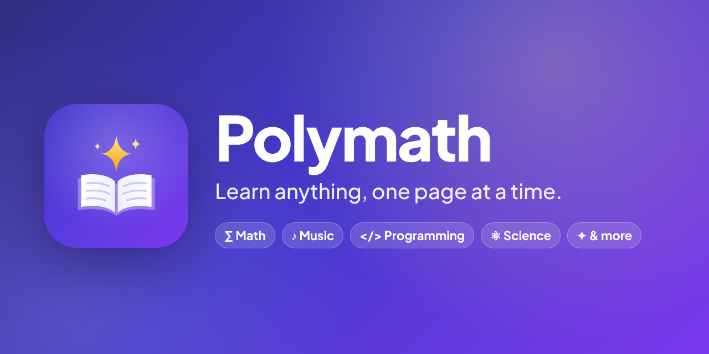
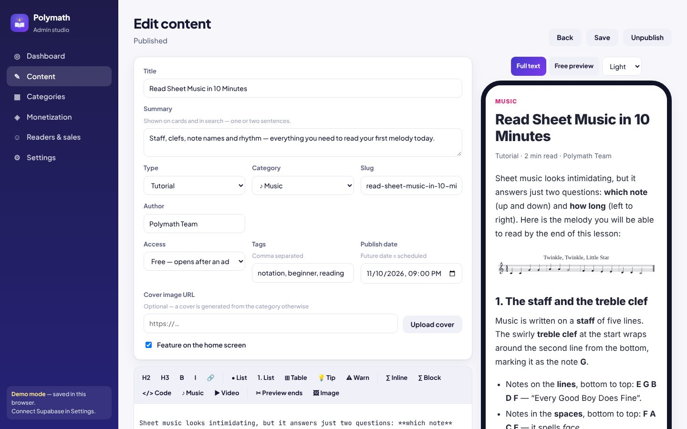

<p align="center">
  
</p>

# Polymath — ebook & learning app for iOS and Android

**Polymath** is a reading app for articles, tips, tutorials and multi‑chapter ebooks on **math, music, programming and more** — with three ways to make money, a separate **admin studio** for publishing, and GitHub Actions that build the **iOS `.ipa`** and **Android `.apk`/`.aab`** for you.

<p align="center"></p>

| | |
|---|---|
| 📱 **One codebase, two platforms** | Expo SDK 58 / React Native 0.88 — builds an iPhone/iPad **IPA** and an Android **APK + AAB** |
| 💸 **Monetization** | **Free tier** opens content after a rewarded ad · **Premium subscription** (monthly/yearly, no ads) · **Pay on demand** with credits to own single ebooks |
| 🛠️ **Admin studio** | Web app to write and publish articles, tips, tutorials and ebooks — math (LaTeX), code, **sheet music** (ABC notation), callouts, images, scheduling |
| 🔐 **Real paywall** | Premium text is protected by Supabase row‑level security; purchases are verified server‑side with RevenueCat |
| 🎨 **Branding** | Logo, app icon (iOS, Android adaptive + themed), splash screen, favicons, banner — all generated from SVG sources |
| 🤖 **Built on GitHub** | CI, iOS IPA, Android APK/AAB, admin → GitHub Pages, Supabase deploy, releases on version tags |

> **Works out of the box.** Without any keys the app runs as a full demo: bundled sample library, Google's test ads and simulated purchases. Add your keys as GitHub secrets when you're ready — see **[docs/SETUP.md](docs/SETUP.md)**.

---

## Get the app

Every push builds the apps on GitHub:

| Workflow | Output | Where |
|---|---|---|
| **iOS build (IPA)** | `Polymath-<version>-<build>-unsigned.ipa` — or a signed App Store IPA (+ TestFlight upload) when signing secrets are set | Actions → *iOS build (IPA)* → run → **Artifacts** |
| **Android build (APK + AAB)** | Installable `.apk` and Play Store `.aab` — optionally uploaded straight to a Google Play track | Actions → *Android build* → run → **Artifacts** |
| **Admin iOS app (IPA)** | `PolymathAdmin-<version>-<build>-unsigned.ipa` — the admin studio as its own iPhone/iPad app | Actions → *Admin iOS app (IPA)* → run → **Artifacts** |
| **Admin web app** | The admin studio, deployed to GitHub Pages from the default branch (installable as a web app too) | `https://<you>.github.io/<repo>/` |

Push a tag like `v1.0.0` and the app workflows attach their files to a **GitHub Release**.

**Publishing on Google Play as an individual?** Follow **[docs/GOOGLE_PLAY.md](docs/GOOGLE_PLAY.md)** — account type, documents, the 12-tester closed test, policy forms, and automated uploads. Store graphics and listing text are ready in [`store/google-play/`](store/google-play).

**Installing the unsigned IPA:** sideload it with [AltStore](https://altstore.io) or [Sideloadly](https://sideloadly.io) using your Apple ID, or add the signing secrets to get an App Store build. Details in [docs/SETUP.md › iOS](docs/SETUP.md#6-ios-signing-testflight-and-the-app-store).

## How the monetization works

```
                       ┌──────────────── reader opens an item ────────────────┐
                       │                                                       │
               FREE item                                               PREMIUM item
                       │                                                       │
   Premium member? ── yes ──► read, no ads                Premium member? ── yes ──► read
          │ no                                                    │ no
   Watched an ad in the last N hours? ── yes ──► read      Owns it (bought with credits)? ── yes ──► read
          │ no                                                    │ no
   ▶ rewarded / interstitial ad (AdMob) ──► read          Paywall: subscribe — or spend credits to own it
```

* **Ads** — Google AdMob rewarded or interstitial ad before free content, plus optional banners. GDPR consent (Google UMP) and Apple App Tracking Transparency included. Switch the ad mode or the unlock window from the admin app.
* **Subscription** — monthly/yearly plans via RevenueCat (App Store + Google Play). Unlocks everything and removes ads.
* **Pay on demand** — readers buy **credit packs** (consumable IAP) and spend credits to own individual premium items. Credits are verified and recorded server‑side, so they're restorable across devices with an account.

More in **[docs/MONETIZATION.md](docs/MONETIZATION.md)**.

## Admin studio

<p align="center"></p>

Write in Markdown with a toolbar for **math** (`$x^2$`), **code**, **sheet music**, tips/warnings, tables, images and video embeds. A live phone preview shows exactly what readers see — including the free preview before the ad or paywall. Manage categories (Mathematics, Music, Programming, Science, Languages, Productivity …), monetization settings, credit packs, readers and sales.

It runs in **demo mode** (saved in your browser) until you connect Supabase from *Settings*. Use it in the browser (GitHub Pages), add it to your home screen, or install the **Polymath Admin** iPhone/iPad app built by the *Admin iOS app* workflow (same code, packaged with Capacitor). Guide: **[docs/CONTENT.md](docs/CONTENT.md)**.

## Repository layout

```
apps/mobile/        Expo app (iOS + Android) — screens in src/app, logic in src/lib + src/state
apps/admin/         Admin studio (React + Vite) — GitHub Pages, and an iOS app via Capacitor (apps/admin/ios)
shared/             Code used by both apps: data types, access rules, the reader template
supabase/           Database migrations, seed data, edge functions, database tests
content/            Starter library in Markdown (rendered by `npm run content` in apps/admin)
branding/           Logo + icon sources (SVG), brand guide, PNG exports, render script
docs/               Setup, Google Play, monetization and content guides; screenshots
store/              Google Play listing text, icon, feature graphic, screenshots, release notes
.github/workflows/  CI · iOS IPA · Android APK/AAB (+ Play upload) · admin iOS IPA · admin Pages · Supabase deploy
```

## Run it locally

```bash
# Admin studio (http://localhost:5173)
cd apps/admin && npm install && npm run dev

# Mobile app — needs a development build because of the native ads/purchases SDKs
cd apps/mobile && npm install
npx expo run:ios       # macOS + Xcode 26.4+
npx expo run:android   # Android Studio / SDK 37

# Preview the mobile UI in a browser (ads and purchases simulated)
npx expo start --web
```

Tests: `npm test` in `apps/admin` (renderer + access rules), `npm test` in `supabase/tests` (database rules in PGlite), `deno test --allow-env supabase/functions/_shared/` (purchase parsing).

## Tech

Expo SDK 58 · React Native 0.88 · Expo Router (native tabs) · react‑native‑google‑mobile‑ads 17 · RevenueCat (react‑native‑purchases 11) · Supabase (Postgres + RLS, Auth, Storage, Edge Functions) · React 19 + Vite 8 · markdown‑it · KaTeX (MathML) · highlight.js · abcjs.

## Next steps

1. Follow **[docs/SETUP.md](docs/SETUP.md)** — Supabase → admin user → RevenueCat + store products → AdMob → GitHub secrets.
2. Replace the placeholder privacy/terms links in *Admin → Monetization*.
3. Change the name/bundle id if you like (`APP_NAME`, `APP_BUNDLE_ID` repository variables) and re-render the brand assets (`branding/README.md`).
